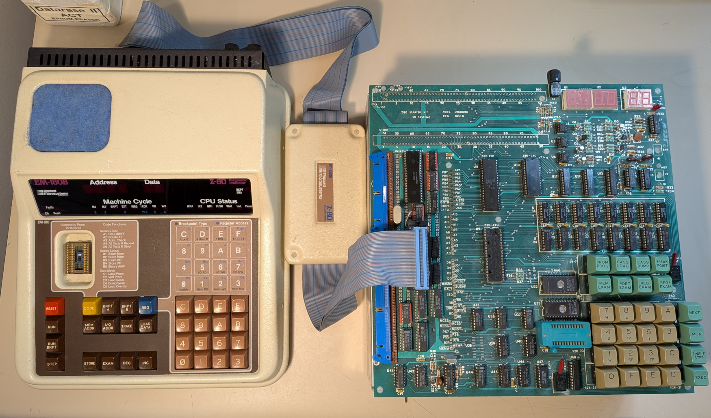

# Z80 Starter Kit Restoration

Programming a Z80 like it was 1979. A rescued S.D. Systems Z80 Starter Kit and Applied Microsystems EM180 Diganostic Emulator. I'm restoring it to working order.

# Details

The S.D. Systems Z80 Starter Kit and Applied Microsystems EM180 Diganostic Emulator are both from the Trenton Computer Festival at Mercer County College, NJ (1992). I ended up getting the Z80 Start Kit for $20 and the EM180 for $10. I had been fortunate enough to worked with the EM189 (6809) version back in the 80's. 

I'm pretty sure that this kit was built and used at Mercer County College, NJ to teach the basics of digital computers and assembly language. I used a similar setup (a SDK-85) at Middlesex County College, NJ. I found that class to be one of the more interesting classes I've ever taken.

I'll get better pictures later. The Z80 Starter Kit was used at Mercer to teach hardware and assembly language. The unit I have is one of their kits carefully assembled by the MCC staff. Under the main board is a wire wrapped static RAM board. If you've ever done wire wrap you can appreciate the amount of work and this one is pretty. Actually the whole thing is pretty and I'm pretty sure these (there would be about a dozen for student labs) were hand made. 

I have a number of these types of development board (8085, 6800, 6809, 68HC11, 68000, etc.) because I started with an Intel SDK-85 (8085) in college. My first computer was an Atari 800XL (still have it and it works). My first job after college was a repair tech at a company that made communication equipment for the newspaper industry (Microcomm - not the modem maker). There I worked with a lot of Motorola products and came to like the Motorola chip set.

## Additions

- Z80 SIO chip (unknown port)
- Extra RAM (unknown address - 8K)
- U33 - Extended ZBug with support for 2 serial ports.

I'm currently working on getting the U32 and U33 ROMs disassembled. At the moment it appears my ROMs may have some bit rot.

## ROM dumps

| File | ROM | Address | Status |
|---|---|---|---|
| `zbug-u32.bin` / `zbug-u32.asm` | U32 - ZBUG monitor | 0000H-07FFH | **Bad dump - do not trust** |
| `zbug-u33.bin` / `zbug-u33.asm` | U33 - Z80 CRT Monitor Ver 1.0 Rev 1.1 | 0800H-0FFFH | Looks clean, labelled listing |

**The U32 dump is corrupt.** Data bit 6 (D6, pin 16 on a 2716) intermittently reads as 1 when it should be 0. For example, the first instruction reads `71 C0 63` instead of `31 C0 23` (`LD SP,23C0H`), and RAM addresses show up as both `23xx` and `63xx`. Bits only ever flip from 0 to 1, and the same byte reads correctly in some places and wrong in others, so it looks like a bad read (socket contact or timing) rather than a damaged ROM. It can't be fixed in software. Any `4xxx` or `6xxx` address in `zbug-u32.asm` is almost certainly one of these errors. U32 needs to be re-read (several times, comparing the dumps) before its listing can be relied on. See the header of `zbug-u32.asm` and `discussion.md` for details.
